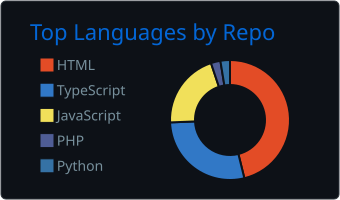
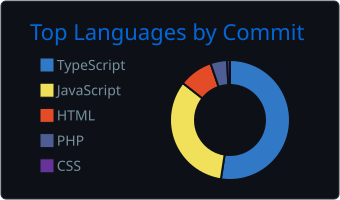
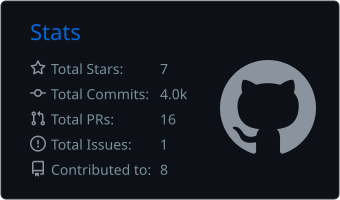
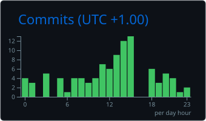

<!-- ═══════════════════════════ HERO ═══════════════════════════ -->

<div align="center">


<a href="https://github.com/Eseoghene94">
  
</a>

<p>
  <a href="https://eseoghenethedeveloper.vercel.app"></a>
  <a href="https://www.linkedin.com/in/david-ojiyovwi-9553b6422"></a>
  <a href="mailto:eseoghenedavid1@gmail.com"></a>
  <a href="https://x.com/eseoghene94"></a>
  <a href="https://www.buymeacoffee.com/eseoghene94"></a>
  
</p>

</div>

<!-- ═══════════════════════════ ABOUT ═══════════════════════════ -->

<table>
<tr>
<td width="55%" valign="top">

### `$ whoami`

```yaml
name:       David Eseoghene Ojiyovwi
role:       Senior / Lead Full-Stack Software Engineer
current:    Lead Software Developer @ Eastwind Tech Base Limited
experience: 6+ years
domains:    [ education, healthcare, e-commerce, energy, aviation, logistics ]
focus:      [ software architecture, system design, cloud & DevOps, AI integrations ]
location:   Lagos, Nigeria 🇳🇬
remote:     open to global collaborations 🌍
```

</td>
<td width="45%" valign="top">

### `$ now --status`

* 🏗️ Leading architecture & delivery across business units at Eastwind Tech Base
* 🤖 Embedding AI features into production workflows
* 📱 Shipping web (Next.js) and mobile apps in React Native — both Expo and bare
* 🚢 Owning CI/CD and cloud deploys on DigitalOcean, Vercel & Render
* 🧑‍🏫 Mentoring developers through code reviews & architecture guidance
* 💬 Ask me about NestJS, Django, FastAPI, Next.js, React Native and system design

</td>
</tr>
</table>

<!-- ═══════════════════════════ STACK ═══════════════════════════ -->

## ⚡ Tech Stack

<table>
<tr>
<td align="center" width="140"><b>Languages</b></td>
<td></td>
</tr>

<tr>
<td align="center"><b>Frontend & Mobile</b></td>
<td>
<br/>


</td>
</tr>

<tr>
<td align="center"><b>Backend</b></td>
<td>
<br/>


</td>
</tr>

<tr>
<td align="center"><b>Data</b></td>
<td>
<br/>

</td>
</tr>

<tr>
<td align="center"><b>Cloud & DevOps</b></td>
<td>
<br/>


</td>
</tr>

<tr>
<td align="center"><b>Integrations</b></td>
<td>


</td>
</tr>
</table>

<!-- ═══════════════════════════ EXPERIENCE ═══════════════════════════ -->

## 💼 Experience

| Role | Company | Period |
| :--- | :--- | :--- |
| **Lead Software Developer** <br/><sub>progressed from Digitalization Lead</sub> | Eastwind Tech Base Limited · Hybrid | 2024 – Present |
| **Senior Full-Stack Developer / Team Lead** | Tiva Creatives · Remote | 2025 – 2026 |
| **Lead Full-Stack Developer** | NodeTent | 2023 – 2024 |
| **Petroleum Engineer** <br/><sub>offshore production operations</sub> | Oil & Gas | 2019 – 2020 |

<sub>🎓 B.Eng Petroleum Engineering, University of Benin · Self-directed switch into software engineering (2020 – 2023) via Axia Africa, Coursera and Udemy.</sub>

<!-- ═══════════════════════════ PROJECTS ═══════════════════════════ -->

## 🚀 Featured Projects

<table>
<tr>
<td width="50%" valign="top">

### 📚 [SchoolBooks](https://schoolbooks.com.ng)

Multi-vendor educational marketplace with bookstores, eBooks, AI-assisted discovery, map-based delivery and integrated payments.


</td>
<td width="50%" valign="top">

### 🍲 Homefoodly

Food-tech ecosystem spanning multiple brands — EpeCatch, Royal Eja Osan, Saadu Hub, Seafoodie and Food Export Academy.


</td>
</tr>
<tr>
<td width="50%" valign="top">

### 📱 [TheOtherWife](https://theotherwife.com)

Cross-platform consumer mobile application.


</td>
<td width="50%" valign="top">

### ⚡ VoltSense

IoT energy monitoring platform with smart metering, MQTT connectivity and analytics dashboards.


</td>
</tr>
<tr>
<td width="50%" valign="top">

### 💊 go2PHARM

Regulated Nigerian e-pharmacy marketplace connecting customers with licensed pharmacies.


</td>
<td width="50%" valign="top">

### 🏫 [TAHMS](https://tahms.com.ng)

School management system and website for The Athalia House Montessori Schools.


</td>
</tr>
</table>

<details>
<summary><b>More projects</b></summary>
<br/>

| Project | What it is | Stack |
| :--- | :--- | :--- |
| 🩺 **MedMeet** | Healthcare platform — patient management, NIN verification, appointment booking | Next.js · NestJS |
| 🎓 **PsalmsWings LMS** | Enterprise learning management system for institutional course delivery | Next.js · NestJS |
| 🛍️ **Complete Market** | Marketplace platform with a Django backend | Django · PostgreSQL |
| 🌐 **[VCTL](https://vctltd.com)** | Company website for VCTL | Next.js · Node.js |

</details>

<div align="center">
  
</div>

<!-- ═══════════════════════════ ANALYTICS ═══════════════════════════ -->

## 📊 GitHub Analytics

<div align="center">


<br/>


<br/>






<br/>


### 🏆 Achievements


</div>

<!-- ═══════════════════════════ SNAKE ═══════════════════════════ -->

## 🐍 Contribution Snake

<div align="center">
<picture>
  <source media="(prefers-color-scheme: dark)" srcset="https://raw.githubusercontent.com/eseoghene94/eseoghene94/output/github-snake-dark.svg" />
  <source media="(prefers-color-scheme: light)" srcset="https://raw.githubusercontent.com/eseoghene94/eseoghene94/output/github-snake.svg" />
  
</picture>
</div>

<!-- ═══════════════════════════ FOOTER ═══════════════════════════ -->

<div align="center">

<br/>

> *"Any sufficiently advanced technology is indistinguishable from magic."* — Arthur C. Clarke


</div>
